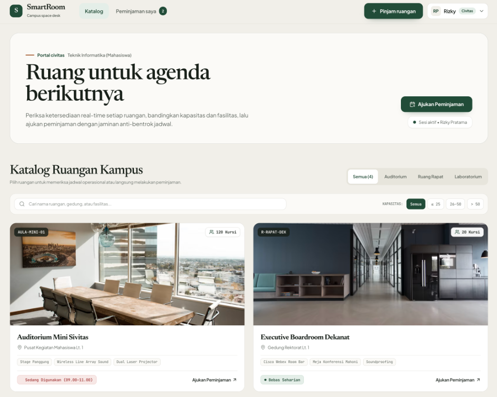
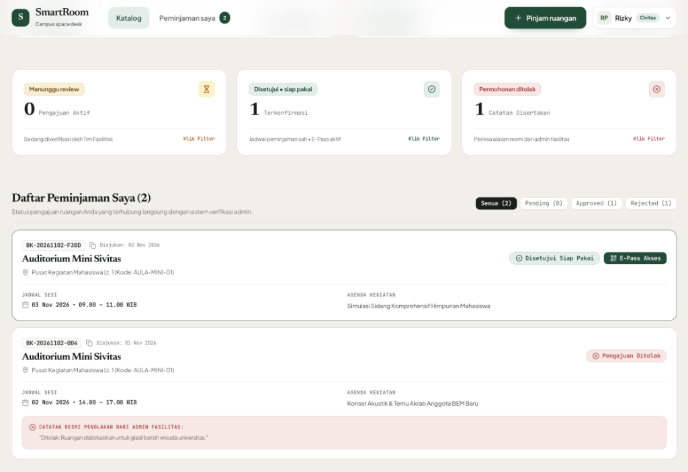
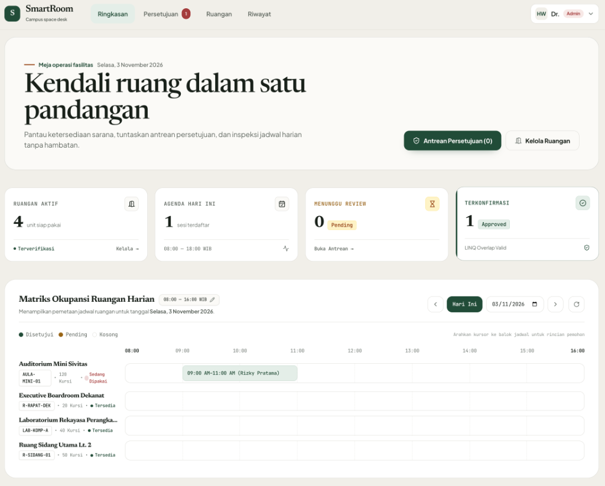
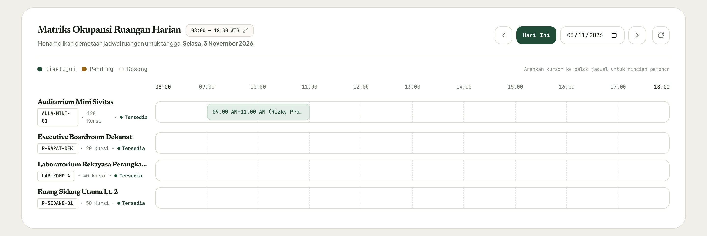

# SmartRoom - Sistem Peminjaman Ruangan Kampus

SmartRoom adalah aplikasi web yang saya buat untuk mempermudah civitas kampus (mahasiswa, dosen, dan staf) dalam mencari dan meminjam ruangan secara online, sekaligus membantu tim pengelola fasilitas kampus mengatur perizinan dan jadwal pemakaian ruangan agar tidak terjadi jadwal bentrok (*double booking*).

Proyek ini saya bangun sebagai portofolio *full-stack web development* menggunakan **ASP.NET Core 8** di sisi backend dan **Vue 3** di sisi frontend.

---

## Masalah yang Ingin Diselesaikan

Di lingkungan kampus, peminjaman ruangan sering kali masih dilakukan manual lewat formulir kertas atau pesan chat. Akibatnya:
- Mahasiswa kesulitan mengetahui ruangan mana yang sedang kosong atau sudah dipakai.
- Sering terjadi jadwal tabrakan karena dua kegiatan diizinkan memakai ruangan yang sama di jam yang sama.
- Konfirmasi peminjaman memakan waktu lama dan bukti izinnya mudah tercecer.

SmartRoom hadir untuk menyelesaikan masalah di atas dengan memberikan informasi ketersediaan ruangan secara real-time dan sistem validasi jadwal otomatis.

---

## Peran Pengguna (Role)

Aplikasi ini memiliki dua peran utama:

### 1. Mahasiswa, Dosen, & Staff (Civitas Akademika)
Sebagai pihak peminjam ruangan, civitas akademika (baik mahasiswa untuk kegiatan organisasi/akademik, maupun dosen dan staf untuk kuliah pengganti, seminar, atau rapat kerja) memiliki akses yang sama untuk:
- **Melihat Katalog Ruangan:** Menjelajahi daftar ruangan yang tersedia lengkap dengan foto, kapasitas kursi, dan fasilitas resmi (seperti proyektor, AC, sound system).
- **Mengecek Status Ruangan:** Mengetahui secara langsung apakah ruangan sedang digunakan pada jam tertentu atau bebas seharian.
- **Mengajukan Peminjaman:** Mengisi formulir peminjaman dengan memilih tanggal, jam mulai, jam selesai, dan tujuan kegiatan.
- **Pencegahan Jadwal Bentrok Otomatis:** Sistem akan langsung memeriksa apakah jam yang dipilih sudah dipesan orang lain. Jika bentrok, sistem akan memberi peringatan dan mencegah formulir dikirim.
- **Melihat Riwayat & Tiket E-Pass:** Memantau apakah pengajuan masih menunggu review, disetujui, atau ditolak. Jika disetujui, pemohon mendapatkan tiket digital (*E-Pass*) yang memiliki kode booking unik dan QR Code untuk ditunjukkan kepada petugas di lokasi.

### 2. Administrator Fasilitas Kampus
Sebagai pengelola ruangan, admin memiliki akses ke:
- **Meja Operasi & Statistik:** Melihat ringkasan data harian seperti jumlah ruangan aktif, agenda yang berlangsung hari ini, serta jumlah pengajuan yang menunggu keputusan.
- **Matriks Jadwal Harian (Timeline):** Melihat jadwal pemakaian seluruh ruangan dalam bentuk matriks waktu (pukul 08:00 sampai 18:00 WIB). Admin juga bisa menyesuaikan rentang jam operasional jika jam kerja kampus berubah.
- **Persetujuan Peminjaman:** Menyetujui permohonan yang masuk atau menolaknya dengan menyertakan catatan alasan resmi agar pemohon tahu kenapa permohonannya ditolak.
- **Manajemen Ruangan:** Menambah data ruangan baru, mengubah spesifikasi (kapasitas/fasilitas), atau menonaktifkan ruangan sementara jika ruangan sedang dalam renovasi atau perbaikan.

---

## Tampilan Aplikasi

### 1. Katalog Ruangan (Halaman Civitas: Mahasiswa & Dosen)
Civitas akademika bisa memfilter ruangan berdasarkan kapasitas dan mencari berdasarkan nama gedung atau fasilitas yang dibutuhkan.


### 2. Riwayat Peminjaman & Tiket E-Pass
Daftar pengajuan peminjaman oleh pemohon. Jika disetujui, tombol E-Pass akan aktif dan bisa dibuka sebagai tiket masuk resmi.


### 3. Dashboard Admin & Matriks Okupansi
Admin bisa memantau jadwal penggunaan semua ruangan hari ini dalam satu layar.


### 4. Matriks Jadwal Harian Penuh (08:00 - 18:00 WIB)
Tampilan timeline jadwal ruangan yang rapi dari jam buka sampai jam tutup operasional kampus.


---

## Teknologi yang Digunakan

- **Backend:** C# / ASP.NET Core 8 Web API & MVC
- **Database & ORM:** Entity Framework Core 8 (mendukung SQLite untuk lokal dan PostgreSQL untuk production)
- **Frontend:** Vue 3 (Composition API), Vite, Tailwind CSS, Lucide Icons
- **Keamanan:** Cookie & Session Authentication, Password Hashing (PBKDF2), Role-Based Route Guards

---

## Cara Menjalankan Proyek di Komputer Lokal

### Prasyarat
- Sudah terinstall [.NET 8 SDK](https://dotnet.microsoft.com/download/dotnet/8.0)
- Sudah terinstall [Node.js](https://nodejs.org/) (versi 18 ke atas)

### Langkah-langkah
1. **Clone repositori ini:**
   ```bash
   git clone https://github.com/reiky03/SmartRoom.git
   cd SmartRoom
   ```

2. **Build frontend:**
   ```bash
   cd frontend
   npm install
   npm run build
   cd ..
   ```

3. **Jalankan aplikasi backend:**
   ```bash
   dotnet run --urls "http://127.0.0.1:5100"
   ```

4. Buka browser dan akses:
   - Aplikasi Web: `http://localhost:5100`

---

## Akun Demo untuk Mencoba

Di halaman login, saya sudah menyediakan tombol **Quick Demo Login** (1 klik langsung masuk) untuk memudahkan mencoba aplikasi:

| Peran | Username | Password |
| :--- | :--- | :--- |
| **Admin Fasilitas** | `admin` | `password123` |
| **Mahasiswa** | `student` | `password123` |
| **Dosen / Staff** | `staff` | `password123` |

---

Dibuat oleh Reiky Aryanando Pratama
